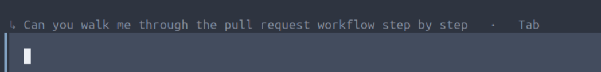

# opencode-prompt-suggestion-plugin

A **Claude Code-style next-prompt suggestion** for the OpenCode TUI. After each
turn, a short "next question / action" is proposed as **ghost text** above the
prompt. **Tab** inserts it into the input field; **Enter** sends it.



## Compatibility

- OpenCode **≥ 2.2.3** (TUI plugin API V2). Built and type-checked against
  `@opencode/plugin@2.2.3`.

> **Why 2.2.3 or later?** A TUI plugin renders inside OpenCode's terminal UI,
> so it is bound to the version of OpenTUI that OpenCode ships. Since OpenCode
> **2.2.3**, TUI plugins require OpenTUI **0.8** (a breaking change in that
> release); earlier 2.x releases ship an older OpenTUI and cannot load this
> plugin. Newer 2.x releases keep working as long as they make no breaking
> change to the TUI plugin API — none as of 2.3.0.

## Installation

1. Clone the repository and install its dependencies:

   ```sh
   git clone https://github.com/ALCyllene/OpencodePromptSuggestionPlugin.git
   cd OpencodePromptSuggestionPlugin
   npm install
   ```

   The runtime bundles (`solid-js`, `@opentui/*`, `@opencode/plugin`) are
   provided by OpenCode itself; installing here is mainly for type-checking and
   keeping the package self-contained.

2. Make the plugin discoverable. Pick one:

   **Symlink into a scanned plugins directory** (recommended):

   ```sh
   # Global (all projects):
   mkdir -p ~/.config/opencode/plugins
   ln -s "$PWD" ~/.config/opencode/plugins/prompt-suggestion

   # Or per-project:
   # mkdir -p <project>/.opencode/plugins
   # ln -s "$PWD" <project>/.opencode/plugins/prompt-suggestion
   ```

   The plugin directories are **watched**: the plugin is loaded/unloaded on the
   fly, without restarting the TUI.

   **Or** reference it from your configuration, in `opencode.json(c)` or
   `cli.json` (a TUI-only plugin belongs in `cli.json` to stay active against a
   remote server):

   ```jsonc
   {
     "$schema": "https://opencode.ai/config.json",
     "plugins": ["/absolute/path/to/OpencodePromptSuggestionPlugin"]
   }
   ```

3. That's it — a suggestion appears after the end of each turn.

## Usage

| Action                          | Effect                                             |
| ------------------------------- | -------------------------------------------------- |
| End of a turn                   | A suggestion is generated (config default model)   |
| `Tab` (a suggestion is shown)   | Inserts the text into the prompt                   |
| `Tab` (no suggestion)           | Normal behavior (prompt autocompletion)            |
| New user prompt                 | Dismisses the current suggestion                   |

## Debug

```sh
PSG_DEBUG=/tmp/psg.log opencode
```

Logs the plugin's life (load, slot, generation, acceptance, prompts) to the
given file.

## How it works

- **Trigger**: the `session.execution.succeeded` event (end of turn), listened
  on via `context.data.on`.
- **Context**: the last 8 messages via `client.session.context`.
- **Generation**: `client.experimental.generate.text` (one stateless LLM call
  per turn — the same trade-off as Claude Code). The model is the config
  default, read via `client.config.get`, requested in the **`low`** variant
  (reduced reasoning effort). When the model has no such variant, the server
  refuses without any LLM call and the plugin retries without a variant.
- **"Generating suggestion…" state**: shown above the prompt while generating
  (dismissed if a new prompt is typed).
- **Display**: the `session.composer.top` slot (above the composer), using the
  `theme.text.muted` color.
- **Acceptance**: a conditional `Tab` keymap layer (`enabled`) that inserts the
  text via `insertText` on the focused renderable.

## Limitations

- One extra LLM call per turn (cost and latency, ~1–5 s depending on the
  model).
- A suggestion is only generated for the session currently on screen.
- `Tab` only inserts while the prompt has focus; otherwise the key is left to
  the host and the suggestion stays displayed.

## Development

```sh
npm install
npm run typecheck
```

The plugin is a single file, `src/tui.tsx`, exposed through the `./tui`
entrypoint. It is typed against the official `Context` from
`@opencode/plugin/tui`.

## License

[MIT](./LICENSE)
